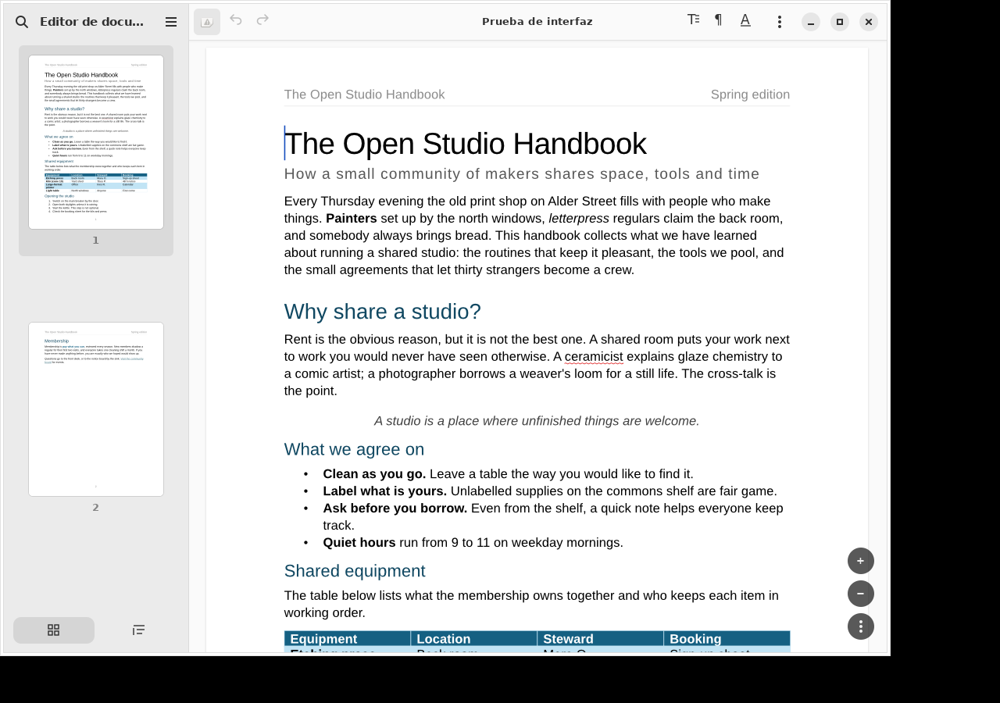
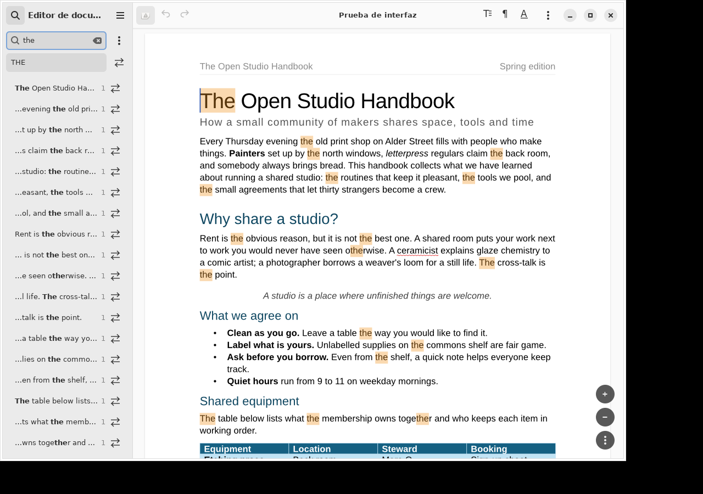
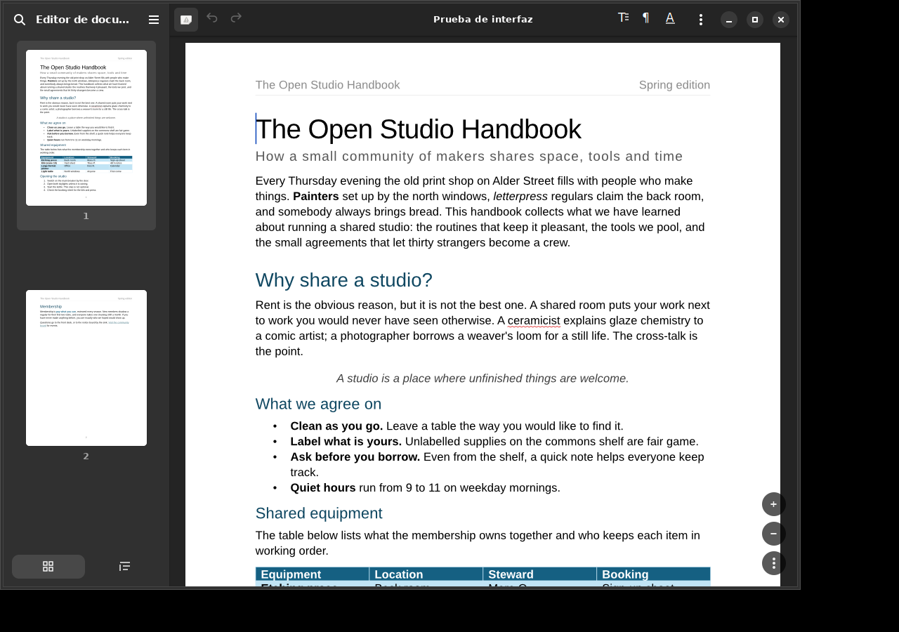

# Leaf


**Create and edit documents.**

Leaf is an experimental document editor for Linux, built with GTK4 and libadwaita. It uses the [WordCraft](https://github.com/storytold/wordcraft) engine for document layout, rendering and editing.

**Alpha development:** use copies of your documents. Compatibility with complex DOCX and ODT files is still being tested. Leaf is an independent project, not an official GNOME application.



## What works today

- Open, edit and save DOCX and ODT documents; export to PDF.
- Text formatting, paragraph settings, styles, tables and inline images.
- Undo/redo, rich clipboard operations and sidebar search with replacement.
- Multiple tabs and windows; page thumbnails and heading navigation.
- Adaptive editing controls, dark appearance and configurable autosave/recovery.

These are implemented features, not a claim of complete Microsoft Word or LibreOffice compatibility. See the [testing guide](docs/TESTING.md) for the areas that need real-document testing.

## Try Leaf

There is **no public installable release yet**. A Flatpak alpha for GitHub Releases is being prepared; it has not been built or installation-tested. Release downloads will appear on the [Releases page](https://github.com/frandavid100/leaf/releases). Leaf is not currently on Flathub.

Experienced testers can build the development branch. Requirements: Rust 1.95 or newer, Git, pkg-config, GTK 4.10+ and libadwaita 1.4+ development libraries. The existing CI runs on Ubuntu 24.04; other host environments have not been comprehensively tested.

```sh
git clone --branch wordcraft-saving https://github.com/frandavid100/leaf.git
cd leaf
cargo test --locked
cargo build --release --locked --features gui --bin wordcraft-gnome
./target/release/wordcraft-gnome
```

The executable and some interface strings still use the previous development name, WordCraft GNOME. The Leaf name and icon are not yet integrated into an installed launcher. GNOME OS users should wait for the Flatpak rather than install development packages on the host.

## Help test it

Start with the [15-minute testing guide](docs/TESTING.md), then [report a bug or document compatibility issue](https://github.com/frandavid100/leaf/issues/new/choose). Spanish and English reports are welcome. Do not upload confidential documents; a small, anonymized reproducer is more useful.



<details>
<summary>Dark appearance</summary>



</details>

Screenshots are actual captures of the last validated development build, using a synthetic test document. They predate Leaf branding integration. [Capture provenance](docs/screenshots/README.md).

## Limits of this alpha

Complex document fidelity, fonts, pagination and format preservation need broader testing. Images are inserted inline; floating-image positioning is not exposed. Tables do not yet have mouse resize handles or formulas. Printing and a complete English interface remain future work. Automated checks do not establish fidelity for arbitrary documents.

For everyday work, keep your original and check saved copies in another editor. Autosave to the original file is an explicit preference; use recovery mode while testing.

## Development and credits

The active branch is **`wordcraft-saving`**. Detailed [Spanish usage notes](docs/USER_GUIDE_ES.md) are also available. See [project status](PROJECT_STATUS.md), [roadmap](ROADMAP.md), [contributing](CONTRIBUTING.md) and [updating WordCraft](UPDATING_WORDCRAFT.md). The repository's default branch still contains an earlier prototype; follow the branch link when browsing the source.

WordCraft remains pinned and unmodified; the native frontend is maintained separately. Leaf is licensed under [GPL-3.0-or-later](LICENSE). Development, tests, documentation and artwork have used AI assistance; [scope and limitations](docs/AI_ASSISTANCE.md).
